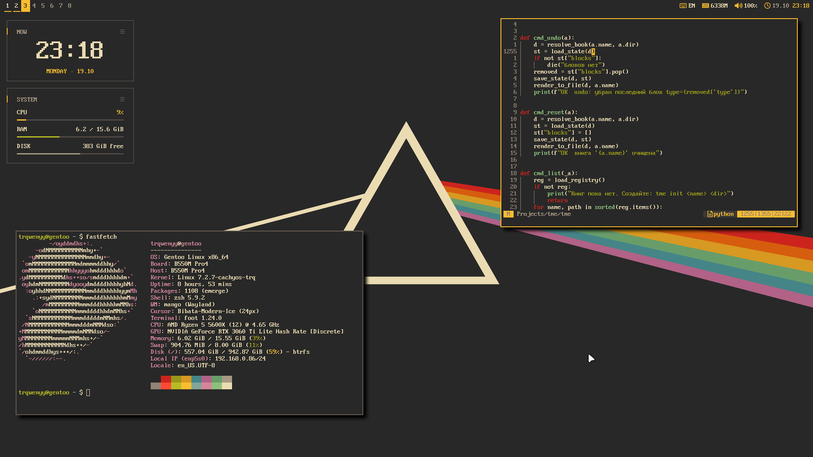
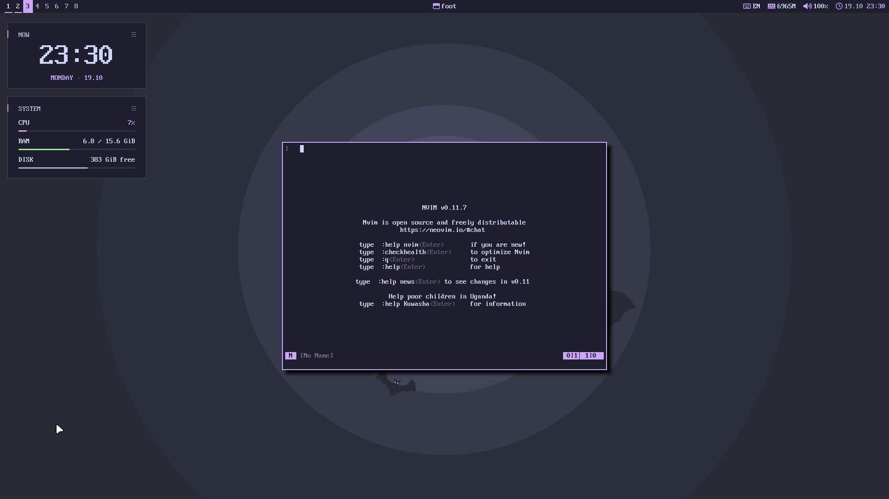
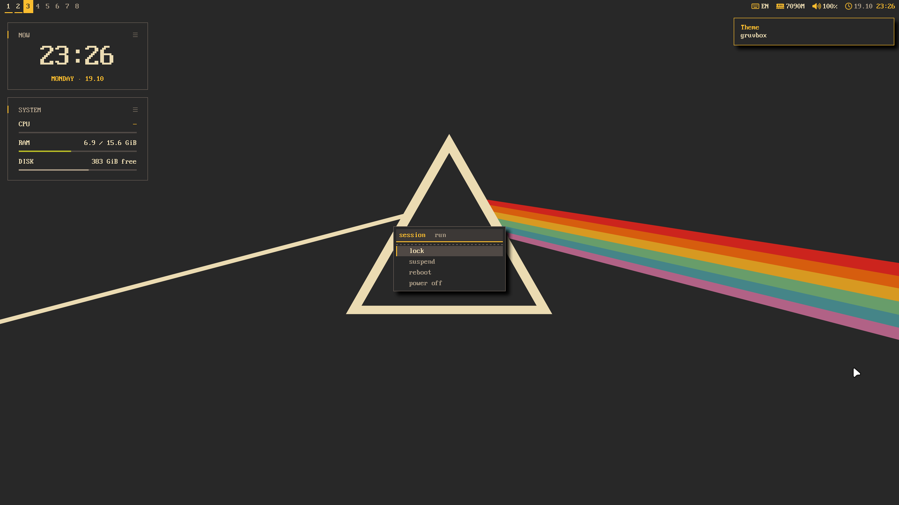
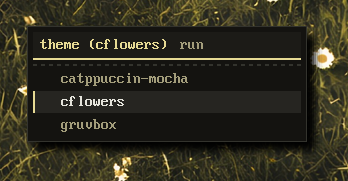
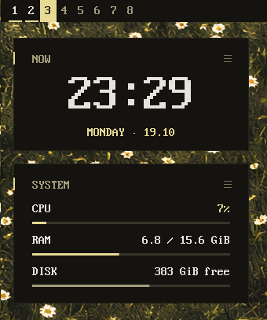
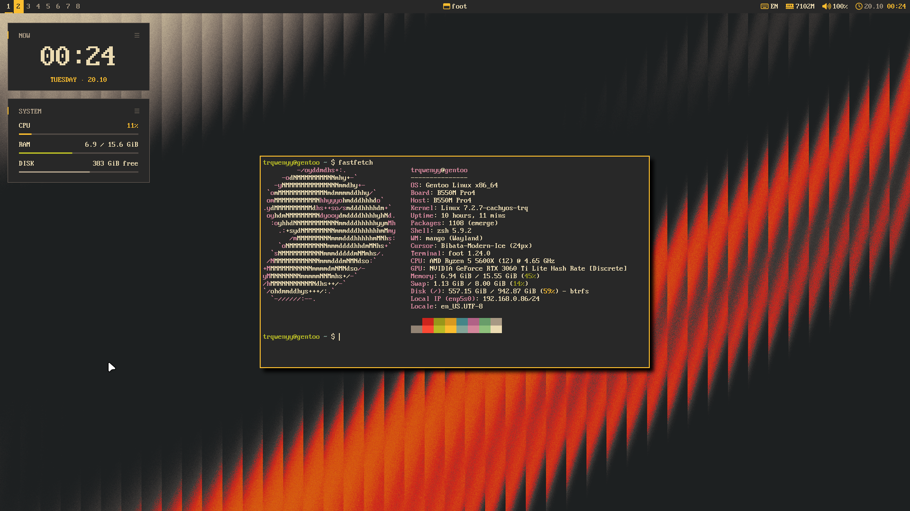

# Mango Dotfiles

Personal [MangoWM](https://github.com/mangowm/mango) dotfiles for Gentoo GNU/Linux.



<details>
<summary>More screenshots</summary>

### Catppuccin Mocha in Neovim



### Gruvbox theme menu



### Theme change notification



### Desktop widgets



### Gruvbox with a different wallpaper



</details>

## Quick Install

```sh
git clone https://github.com/fxmfxmfx/mango-dotfiles.git
cd mango-dotfiles
./scripts/check-deps.sh
./scripts/install.sh --dry-run
# If your primary output is not DP-1, apply the sed example in docs/customize.md.
# Edit .config/mango/conf.d/00-monitors.conf if your monitor layout differs.
./scripts/install.sh
```

This repo mirrors `$HOME` for dot directories such as `.config` and `.local`.
The installer backs up overwritten files by default. It installs the bundled
MxPlus IBM VGA font, downloads Nerd Fonts and copies GTK settings,
the bundled Gruvbox Kvantum preset, Qt6ct settings and Adwaita icon selection
as regular dotfiles. The GTK theme itself is a separate prerequisite; see
[application themes](docs/app-themes.md). The dry run shows what would be copied.

For an offline config update when fonts are already installed, use
`./scripts/install.sh --skip-fonts`. Each run uses its own backup directory.
If you set `DOTFILES_BACKUP_DIR`, choose a fresh directory: existing backup
files are never overwritten, and a collision stops the installer.

In a terminal, installation asks whether to enable **Alt+Shift** keyboard layout
switching, then asks for the second layout code (default `ru`, with `us` first).
Enter another code such as `de` or `ua`, or `?` to list available layouts.
Codes are checked against installed XKB data; invalid choices are requested
again. This prompt requires `xkeyboard-config` (or an equivalent XKB data
directory). Declining switching installs only `us`.

The installer also asks for the primary monitor connector (default `DP-1`).
Enter `?` to list outputs when `wlr-randr` is available. The selected name is
applied to MangoWM, rs-yambar, rs-wwidget and `layout.sh`; resolution and screen
position remain in `.config/mango/conf.d/00-monitors.conf` for manual editing.

For installation without prompts, pass `--keyboard-layouts us,ru` or
`--keyboard-layouts us`, and optionally `--monitor-output DP-1` (replace it
with your connector name). Without a terminal or during a dry run, no questions
are asked; without these options, the repository's keyboard and monitor
defaults are copied. The installer prints the input config path so you can
customize it later.

Run Mango from a TTY with:

```sh
~/.local/bin/start-mango.sh
```

The setup is intentionally not distro-neutral. It assumes MangoWM, GNU userland,
Wayland tooling and a POSIX-compatible shell.

## Contents

- `.config/mango` - MangoWM session, monitor rules, key binds and autostart
- `.config/desktop-themes` - shared JSON palettes; see [the theme guide](docs/themes.md)
- `.config/rs-wwidget` - desktop widgets
- `.config/rs-yambar` - top bar with Mango workspace and keyboard-layout scripts
- `.config/foot`, `.config/rofi`, `.config/dunst` - terminal, launcher and notifications
- `.config/vesktop` - bundled Discord client themes
- `.config/nvim` - Neovim config using lazy.nvim (minimal on purpose)
- `.local/bin` - theme, terminal, screenshot, clipboard, layout, portal and wallpaper helpers
- `scripts` - installer and dependency checker
- `Wallpaper` - wallpapers used by the wallpaper picker
- `docs` - package list and customization notes for forks

## Global Themes

One JSON file controls MangoWM, rofi, foot, Neovim, dunst, rs-yambar and
rs-wwidget. Each theme can assign a default image wallpaper: cflowers uses
`~/Wallpaper/cupsizeflowers.jpg`, Gruvbox uses `~/Wallpaper/prism.png`, and
Catppuccin Mocha uses `~/Wallpaper/gentoo.png`. Open terminals
and editors update without restarting. Optional app mappings also synchronize
LibreWolf and Vesktop. GTK/Qt preset installation and synchronization are opt-in.

```sh
desktop-theme --check gruvbox
desktop-theme gruvbox
```

See [docs/themes.md](docs/themes.md) for installation, the complete palette
format, custom themes, wallpaper paths, component overrides and troubleshooting.
The previous URL/video wallpaper and wallpaper-derived color helpers are retired.

## Browser and app themes

The bundle includes three signed browser XPIs (two themes and the switcher),
its local handler, and three Vesktop CSS files (two presets and Desktop Theme).
After installing the dotfiles, run `desktop-theme-browser-setup` and install the
three printed XPI files once through `about:addons`. In Vesktop, enable only
Desktop Theme once. These setup steps persist across restarts.

The optional `./scripts/install-app-themes.sh` downloads the ready-made
Catppuccin GTK/Qt presets; the normal installer does not run it. See
[docs/app-themes.md](docs/app-themes.md) for setup, assignments and GTK/Qt details.

## Compatibility Notes

- The `rs-yambar` and `rs-wwidget` binaries in `.local/bin/` were compiled on a specific system and may
  not run on yours due to glibc version differences. If it fails, rebuild from
  source: https://github.com/fxmfxmfx/rs-yambar and https://github.com/fxmfxmfx/rs-wwidget
- Monitor config is machine-specific: `DP-1` at `1920x1080@170` and `HDMI-A-1`
  at `1920x1080@60`. Edit `.config/mango/conf.d/00-monitors.conf` before using
  this on another machine. See Mango's monitor docs:
  [mangowm.github.io/docs/configuration/monitors](https://mangowm.github.io/docs/configuration/monitors).
- [rs-yambar](https://github.com/fxmfxmfx/rs-yambar) is pinned to `DP-1` in
  `.config/rs-yambar/config.toml`. The workspace script can read
  `YAMBAR_MANGO_OUTPUT`; if you change outputs after installation, update the
  bar config and click actions too.
- `rs-wwidget` is also pinned to `DP-1` in
  `.config/rs-wwidget/config.toml`; change its `monitor` value for another
  display. See [monitor customization](docs/customize.md#bar-output) for both
  output settings and the Mango monitor config.
- `DP-1` is the default primary connector in the repository configs. During
  interactive installation, the installer asks which connector to use and
  updates MangoWM, rs-yambar, rs-wwidget and `layout.sh`; for unattended runs,
  pass `--monitor-output NAME`. This changes the connector name only. Edit
  `.config/mango/conf.d/00-monitors.conf` separately for resolution, refresh
  rate, position or additional outputs.
- `layout.sh` defaults to `DP-1`; override with `MANGO_OUTPUT=...` if needed.
- Wallpaper picker reads images from `~/Wallpaper` by default. Override with
  `WALLPAPER_DIR=/path/to/wallpapers`.
- Portal autostart uses `.local/bin/start-portals.sh`, which starts the main,
  GTK and wlr portal binaries after checking normal `$PATH` lookup and common
  backend locations.
- See `docs/customize.md` for the files that usually need local edits.

## Dependencies

Run the checker first:

```sh
./scripts/check-deps.sh
```

It is the source of truth for this setup. If it reports everything you need as
`ok`, you usually do not need to audit this list by hand. The list below is here
mainly so missing tools have links and are easier to install.

Portal checks are split on purpose:

- Gentoo: portal binaries commonly live under `/usr/libexec`, so the checker
  reports those paths separately.
- Most other distros: portal binaries are usually found through `$PATH` or under
  `/usr/lib`.

The important part is that each portal has at least one `ok` line. `notfound` for
a Gentoo-only path is fine on a non-Gentoo system, and the reverse is fine on
Gentoo.

### Mango Session

- [`mango`](https://github.com/mangowm/mango)
- `dbus`
- `dbus-run-session`
- `pipewire`
- `pipewire-pulse`
- `wireplumber`
- `xdg-desktop-portal`
- `xdg-desktop-portal-wlr`
- `xdg-desktop-portal-gtk`
- [`foot`](https://github.com/DanteAlighierin/foot)
- [`rofi`](https://github.com/DaveDavenport/rofi)
- [`awww`](https://github.com/NotAShelf/awww)
- [`rs-yambar`](https://github.com/fxmfxmfx/rs-yambar)
- [`rs-wwidget`](https://github.com/fxmfxmfx/rs-wwidget)
- [`dunst`](https://github.com/dunst-project/dunst)

### Script Dependencies

These are mostly command-line tools used by helper scripts. Prefer
`./scripts/check-deps.sh` over manually reading this section.

- `bash`
- `curl` and `tar` (normal font installation)
- GNU `coreutils`
- `findutils`
- `gawk` or compatible `awk`
- `grep`
- `sed`
- `head`
- `procps`/`psmisc` tools such as `pgrep` and `killall`
- [`wl-clipboard`](https://github.com/bugaevc/wl-clipboard)
- [`cliphist`](https://github.com/sentriz/cliphist)
- [`wayfreeze`](https://github.com/Jappie3/wayfreeze)
- [`grim`](https://gitlab.freedesktop.org/emersion/grim)
- [`slurp`](https://github.com/emersion/slurp)
- [`swappy`](https://github.com/jtheoof/swappy)

### Optional Apps And Tools

Optional apps:

- `mpv`
- `imv`
- `thunar`
- `librewolf`
- `pavucontrol`

Other commands reported as optional by `check-deps.sh`:

- `doas`
- [`neo`](https://github.com/st3w/neo)
- `make` and `gcc` (for compiling Treesitter parsers)
- `magick` (ImageMagick) and `ffmpeg`
- `xsettingsd` and `gsettings`
- `kvantummanager` and `qt6ct`
- `unzip`, `sha256sum` and `fc-cache`

### Shell And Editor

- `zsh`
- `nvim`
- `git`
- `make`
- `gcc` or another C compiler for Treesitter parsers
- `python3` and its `msgpack` module
- `btop`
- `fastfetch`
- [`ripgrep`](https://github.com/BurntSushi/ripgrep)
- [`fd`](https://github.com/sharkdp/fd)
- [`eza`](https://github.com/eza-community/eza)
- [`bat`](https://github.com/sharkdp/bat)
- [`dust`](https://github.com/bootandy/dust)

### UI And Themes

- [`Symbols Nerd Font Mono`](https://www.nerdfonts.com/) - install via [nix-fonts](https://github.com/nerd-fonts/nerd-fonts) or your package manager
- [`JetBrainsMono Nerd Font`](https://www.nerdfonts.com/) - install via [nix-fonts](https://github.com/nerd-fonts/nerd-fonts) or your package manager
- [`Gruvbox-Dark-Soft`](https://github.com/morhetz/gruvbox) - external GTK theme
  prerequisite; install under `~/.themes` or another GTK theme directory
- `gruvbox-kvantum` - Kvantum style for Qt apps (bundled in `.config/Kvantum`)
- Catppuccin Mocha/Mauve GTK 3/4 and Kvantum themes are available through the optional `scripts/install-app-themes.sh` installer
- Signed LibreWolf themes: Gruvbox Dark and Catppuccin
- Vesktop CSS themes: Gruvbox Sharp and Catppuccin Mocha Sharp; both are bundled in `.config/vesktop/themes`
- `Adwaita` - GTK/Qt icons; `Papirus-Dark` - rofi icons; `Bibata-Modern-Ice` - cursor

MxPlus IBM VGA 8x16 MidTilde font is included in `fonts/` directory.

For a more readable package list, see `docs/packages.md`.

## Repository checks

```sh
python3 scripts/check-repo.py
```

This checks JSON/TOML data and script syntax, then runs the regression tests,
including installation and backups in a temporary home. It does not download
anything or change your desktop. Python 3 and Git are needed; TOML validation
uses Python 3.11+. Shell and JavaScript syntax checks use installed `sh`,
`bash`, `zsh` and `node`; unavailable validators are reported as skipped.

## Key Binds

- `Super+Return` - terminal
- `Super+Esc` - launcher
- `Super+W` - browser
- `Super+V` - clipboard history
- **Super + grave (backtick)** - theme menu (`cflowers`, `gruvbox`, `catppuccin-mocha` and custom JSON themes)
- `Super+X` - local image wallpaper picker; colors stay unchanged
- `Super+/` - emoji picker
- `Print` - monitor screenshot to clipboard
- `Ctrl+Print` - full screenshot to clipboard
- `Super+Shift+S` - area screenshot to clipboard
- `Super+Shift+D` - area screenshot through Swappy
